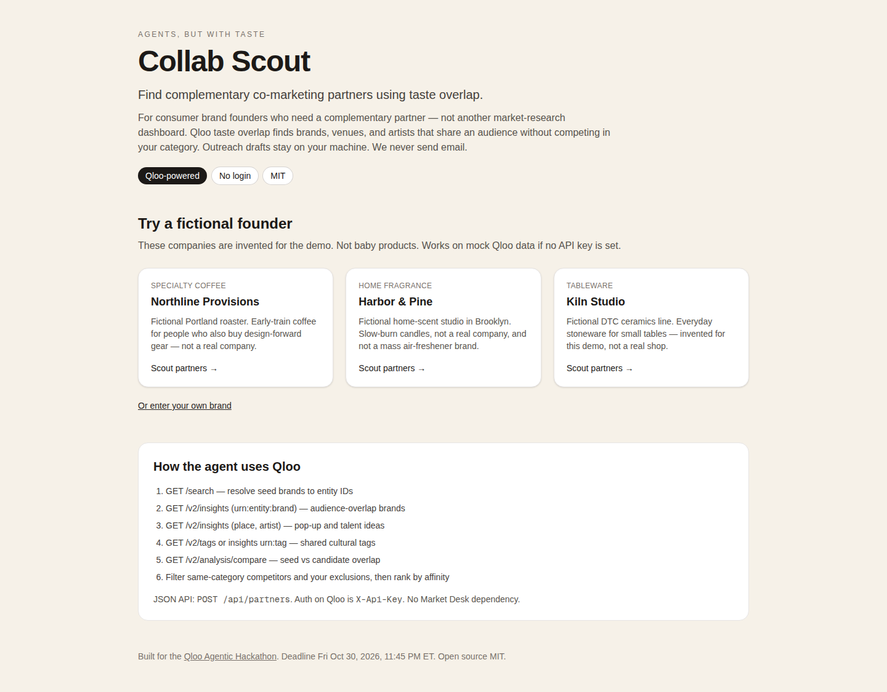
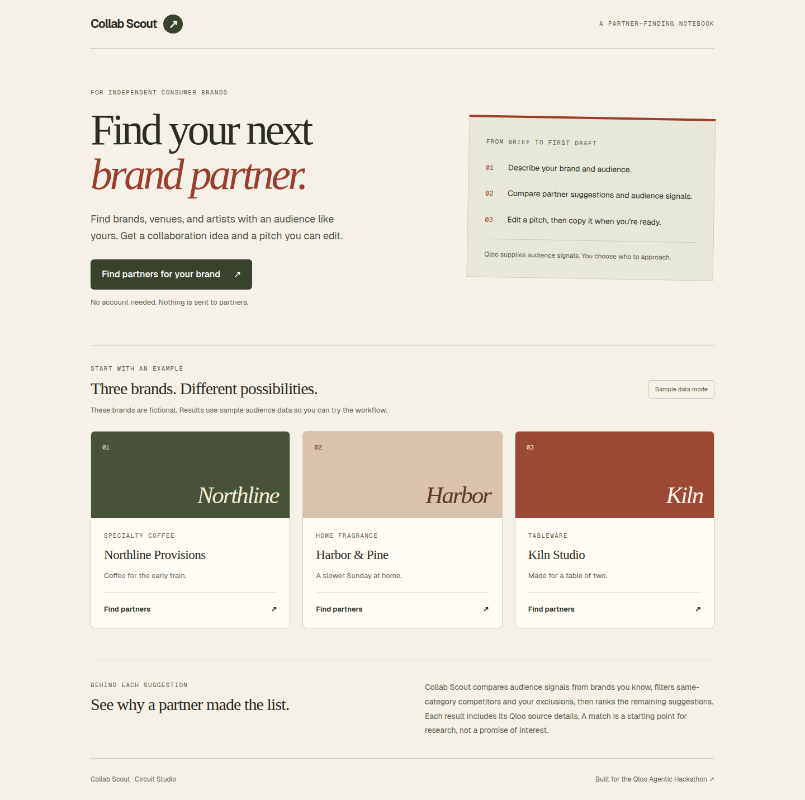
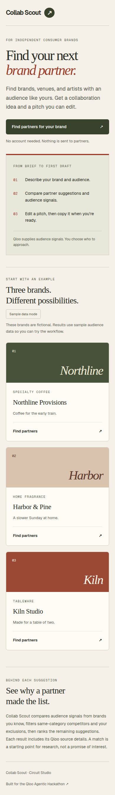

Historical Collab Scout audit; current product: Sitebrief.

# Collab Scout UI, UX, and copy audit

Date: 2026-10-20. Baseline: `d1b521ae625fb9eff1e78d7760480a28ca6f6148`.

Scope: homepage, custom brief, fictional-brand search, result cards, draft editing/copying, outreach status, and Qloo source inspection. Applied the workspace `frontend-design`, `web-design-guidelines`, `browser-automation`, and `no-ai-slop` skills. Web Interface Guidelines were fetched from the upstream Vercel source on the audit date.

## Findings and changes

Locations below refer to the baseline commit, before this PR.

### Homepage and visual hierarchy

- `app/page.tsx:14` - binary contrast: “not another market-research dashboard.” Replace with the specific job: find brand partners and prepare an editable pitch.
- `app/page.tsx:29` - negative listing / stale context: “Not baby products.” Remove it. Explain fictional examples once.
- `app/page.tsx:57` - endpoint names dominate the main task flow. Keep technical source details in an expandable result log; explain matching in ordinary language on the homepage.
- `app/globals.css:25` - Arial overrides the loaded font. Use the existing body font with editorial serif headings, olive/terracotta accents, and a consistent notebook layout.
- `app/globals.css:15` - automatic dark colors conflict with hardcoded light surfaces. Keep the current design explicitly light.

### Forms and results

- `app/scout/[id]/CustomScoutForm.tsx:28` - silently truncates the fourth reference brand. Reject excess names with a field-focused explanation instead.
- `app/scout/[id]/CustomScoutForm.tsx:56` - “Continue” does not identify the next step. Use “Review your brief,” preserve inputs, and provide an edit path.
- `app/scout/[id]/ScoutRunner.tsx:145` - pitches are read-only despite the product requirement for editable outreach. Add labelled draft fields and copy the edited text.
- `app/scout/[id]/ScoutRunner.tsx:59` - clipboard rejection is unhandled. Show a manual-copy fallback and announce success/failure.
- `app/scout/[id]/ScoutRunner.tsx:26` - blocked localStorage can break results; run-scoped keys do not restore status on a new search. Handle unavailable storage and scope status to the brand and partner. Old run-specific keys are not migrated.
- `app/scout/[id]/ScoutRunner.tsx:111` - internal enum/model identifiers are shown as interface copy. Use “Live Qloo data,” “Sample audience data,” and plain draft-source labels.
- Shared UI - add skip navigation, visible keyboard focus, 44px form targets, reduced-motion handling, long-text wrapping, and announced asynchronous states.

### Draft copy and uncertainty

- `lib/agent/canned.ts:84` - unsupported benefit: “lets each brand keep its margin while sharing checkout traffic.” Replace with a proposed gift set and a reminder to agree pricing/fulfillment.
- `lib/agent/canned.ts:104` - “Qloo taste data shows our audiences overlap” claims research even for mock data. Label sample-data drafts, remove the claim from pitch templates, and keep sample/live labels visible near results.
- `lib/agent/orchestrator.ts` - instruct synthesis to use direct language, avoid invented commercial outcomes, and retain sample-data uncertainty. This is a prompt improvement, not a guarantee about every future model response.

## What changed

The homepage now leads with one task and one primary action. Fictional examples have distinct, typographic covers. The search flow keeps source inspection available without making people read API documentation. Drafts are editable, local status is recoverable across searches, and provider/fallback labels do not imply live research.

## Verification

- `npm test -- --runInBand`: 30 tests passed, including a sample-data claim regression.
- `npm run lint`: passed.
- `npm run build`: passed.
- Browser checks: excess references rejected, brief edits preserved, actual sample search produces results, edited draft copied, outreach status restored after a new search, denied clipboard access shows a manual alternative.
- Keyboard skip navigation and visible focus checked; no document-level horizontal overflow on homepage/custom/example routes at 390px.
- Axe WCAG A/AA: 0 violations on the homepage, custom brief, example brief, and populated sample results with expanded sources. These checks supplement, rather than replace, screen-reader testing.
- Test searches used local sample data and template drafts. No Qloo or Gemini credentials were loaded; no paid provider calls or outreach were made.

## Visual evidence

Before: hosted baseline, 1440px. After: local production build, 1440px and 390px, sample-data mode.

## Remaining limits

Live Qloo and Gemini generation still require the deployment acceptance checks. This PR does not configure credentials, send messages to partners, add server persistence, or change matching/ranking rules. Unsaved draft edits remain page-local and are labelled as such; browser status storage remains browser-specific.
